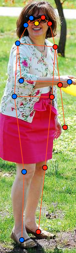
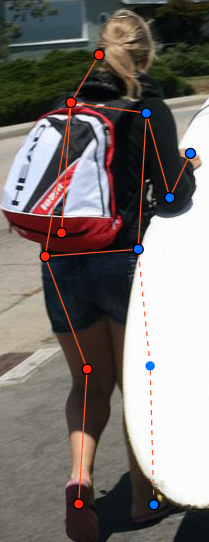
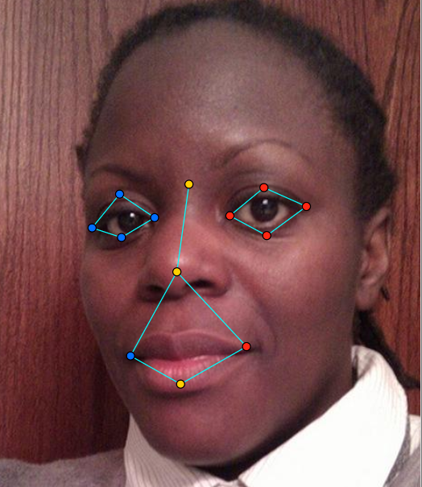
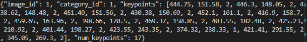

# Báo cáo cá nhân — HoVaTen-MSSV

Đổi tên file theo quy tắc `MSSV_HoTen.md`. Ví dụ: `20241234_NguyenVanAn.md`.

Dữ liệu: 12 ảnh người COCO val2017 (Lin et al., 2014) và 8 ảnh chân dung Wikimedia Commons, chỉ dùng trong lớp.

## 0. Thông tin học viên

- Họ tên:Nguyễn Viết Minh Hoàng
- MSSV:2A202603281
- Email:mihhoang307@gmail.com
- Link repository:https://github.com/hoangnvm307/K5-L2-DAY04-NguyenVietMinhHoang-2A202603281-KeypointPose
- Phiên bản CVAT (Help → About):Server version: 2.74.1|UI version: 2.74.1
- Máy: hệ điều hành Win * RAM 8 GB · chạy CVAT chế độ đầy đủ / lite
- Bộ ảnh (`src/exports/assignment.json` do `lab.py setup` tạo): có 
- Giờ bắt đầu:16h30
- Giờ kết thúc:18h15

## 1. Kiểm tra label (CP0)

| Label | Kiểu | Số điểm | Tên điểm đúng bảng của lab? | Đúng thứ tự? | Số cạnh |
|---|---|---:|---|---|---:|
| `person` | | | | | |
| `face` | | | | | |

Mẫu `person` dựng theo người quay mặt về camera (các điểm `left_*` nằm bên phải khung mẫu)? Có 

Cách đổi cờ `occluded` / `outside` cho **một điểm** trên phiên bản CVAT này (một câu):

click vào point chọn Q/O

## 2. Số lượng đã gán và thời gian (CP1, CP2)

| Nhóm ảnh | Số ảnh | Số skeleton đã gán | Số người dưới 60 px (không gán) | Số poster / gương / màn hình bỏ qua | Thời gian (phút) |
|---|---:|---:|---:|---:|---:|
| `easy` | 5 | | | | |
| `occluded` | 3 | | | | |
| `back` | 2 | | | | |
| `small` | 1 | | | | |
| `crowd` | 1 | | | | |
| `faces` | 8 | | — | | |

- Số ảnh người đã xong ở mốc phút 105: 10 / 10
- Thời gian thực tế (phút): CP1 60 · CP2 30 · CP3
- Ảnh tốn thời gian nhất là ảnh nào, vì sao?
000000043500.jpg vì người nhỏ và quay ngược nhau

...

## 3. Bảng ca khó (CP1, CP2)

Mỗi điểm bạn phân vân một dòng, nhất là phân vân giữa `v = 1` và `v = 0`, hoặc không chắc hướng người.

| Ảnh | Người / mặt | Điểm | Cờ đã chọn | Phân vân giữa | Lý do chọn |
|000000021235.jpg|Trượt tuyết|Right_Ankle|v=1|v=1 và v=0|vẫn xác định được vị trí|


## 4. Bảng tự review (CP3)

Đi từ ảnh cuối về ảnh đầu. 5 ảnh người (ít nhất 2 ảnh `back` hoặc `crowd`) và 3 ảnh mặt. Ít nhất 8 dòng, kể cả dòng `ok`. Ghi lỗi trước, sửa sau.

Mã lỗi dùng đúng một trong: `lr_swap`, `vis_flag`, `position`, `missing`, `extra`, `ok`.

| Ảnh | Người / mặt | Điểm | Mã lỗi | Ghi chú | Đã sửa? |
|---|---|---|---|---|---|
| `000000542160.jpg` (`crowd`) | Người #2 | `knee`, `ankle` trái/phải | `lr_swap` | Đã gán đúng,không cần sửa | Không |
| `000000521817.jpg` | Người #2 | `eye` trái/phải | `lr_swap` |  Đã gán đúng,không cần sửa | Không |
| `000000521817.jpg` | Người #1 | `eye` trái/phải | `lr_swap` |  Đã gán đúng,không cần sửa | Không |
| `000000508269.jpg` | Người #1 | `ankle` trái/phải | `lr_swap` |  Đã gán đúng,không cần sửa | Không |
| `000000463932.jpg` | Người #1 | `eye` trái/phải | `lr_swap` |  Đã gán đúng,không cần sửa | Không |
| `000000043500.jpg` (`back`) | Người #2 | `eye`, `elbow`, `wrist` trái/phải | `lr_swap` | Đã gán đúng,không cần sửa | Không |
| `face_324513.jpg` (`kinh_ram`) | Mặt #1 | Các điểm mắt bị kính che | `vis_flag` | File xuất ghi mọi điểm mặt là `v = 2`; cần kiểm kính râm tối và chuyển điểm mắt bị che sang `occluded` nếu đúng quy tắc. | Đã sửa |

Tổng hợp số lỗi theo mã:

| `lr_swap` | `vis_flag` | `position` | `missing` | `extra` | `ok` |
|---:|---:|---:|---:|---:|---:|
| 6 | 1 | 0 | 0 | 0 | 2 |

Điểm còn phân vân giữa `v = 1` và `v = 0` (ghi cả hai lựa chọn và lý do chọn):
Như đã ghi ở trên là Right_Ankle ở ảnh người trượt tuyết và chọn v=1 do vẫn xác định được vị trí

## 5. Kiểm file xuất và kết quả tự kiểm (CP4)

Tự kiểm tay trong file JSON:

| File | Người / mặt kiểm (ảnh, thứ tự) | Số phần tử `keypoints` | Điểm `outside` ra `v = 0`, `occluded` ra `v = 1`? | `num_keypoints` khớp? |
|---|---|---:|---|---|
| `HoVaTen_persons.zip` | | | | |
| `HoVaTen_persons.zip` | | | | |
| `HoVaTen_faces.zip` | | | | |

Sau khi xuất, CVAT ghi `occluded` thành `v = 1` và `outside` thành `v = 0`. Tọa độ của điểm `outside` trong file là tọa độ cũ (không phải `0, 0`).

Hai job đã chuyển sang completed trên CVAT? Có 

Dán phần **TÓM TẮT** in ra từ `src/check_submission.py`:

- File person: NguyenVietMinhHoang_persons.zip
  Số ảnh: 12 · số skeleton `person`: 18 · mỗi annotation 51 số
  Skeleton theo ảnh: 000000007281=2, 000000021235=1, 000000043500=2, 000000137767=1, 000000179201=1, 000000220045=1, 000000463932=1, 000000493741=1, 000000508269=1, 000000518966=2, 000000521817=2, 000000542160=3
  Cờ v: v=2 255 (83%) · v=1 23 (8%) · v=0 28 (9%)
  num_keypoints trung bình: 15.4
- File face: NguyenVietMinhHoang_faces.zip
  Số ảnh: 8 · số skeleton `face`: 8 · mỗi annotation 39 số
  Skeleton theo ảnh: face_141135=1, face_261458=1, face_279764=1, face_324513=1, face_415073=1, face_514826=1, face_53580=1, face_85624=1
  Cờ v: v=2 104 (100%) · v=1 0 (0%) · v=0 0 (0%)
  num_keypoints trung bình: 13.0
- Ghi chú: 28 điểm v = 0 vẫn mang tọa độ cũ (CVAT 2.x xuất như vậy; chuẩn COCO ghi 0,0). Không phải lỗi: điểm v = 0 bị bỏ qua khi huấn luyện và khi chấm.
- Số [LỖI]: 0 · số [CẢNH BÁO]: 6
Kết quả: ĐẠT (đọc lại từng cảnh báo ở trên)

Các `[CẢNH BÁO]` còn giữ nguyên và lý do:cảnh báo ngược bên nhưng tôi đã làm đúng rồi.

...

## 6. Ảnh chụp màn hình

1. Label `person` trong label constructor (đủ 17 điểm có tên):

   

2. Một người quay lưng đã gán, cờ đã đặt:

   

3. Một khuôn mặt đã gán 13 điểm, phóng to vùng mắt:

   

4. Một đoạn JSON xuất của một người:

   

Nguồn ảnh: COCO val2017 / Wikimedia Commons.

## 7. Tự đánh giá

1. Lỗi bạn mắc nhiều nhất hôm nay, và cách bạn sẽ tránh ở dự án thật:

   Xóa thiếu các keypoint v=0,xóa luôn khi không thấy thay vì xóa cuối cùng khi làm xong phần v=1,v=2.

2. Một quy tắc bạn đề xuất thêm vào guideline (kèm ảnh ví dụ nếu có):

   KHông có

3. Nhãn của bạn đi vào model ở đâu? Chọn một lỗi bạn đã sửa và nói nó sẽ làm model học sai thế nào (heatmap, trọng số trong loss, hay bước lật ảnh):

   Ở ảnh `face_324513.jpg`, ban đầu tôi để các điểm mắt bị kính râm tối che ở `v = 2`, rồi sửa thành `occluded` (`v = 1`). Trong cách huấn luyện mô tả ở lab, cả `v = 1` và `v = 2` đều tạo heatmap tại tọa độ đã gán và có trọng số 1 trong loss, nên chỉ đổi cờ mà giữ nguyên tọa độ sẽ không đổi heatmap hay trọng số loss. Tuy nhiên, cờ `v = 2` sai nói rằng mắt nhìn thấy được; nếu model có học trạng thái visibility, nó sẽ học sai từ nhãn này. Việc sửa cờ giữ đúng ý nghĩa dữ liệu: mắt bị che nhưng vị trí vẫn ước lượng được.

## 8. Khó khăn và lỗi kỹ thuật

Các ảnh bị lật ngược lại gán keypoint hơi khó

## Bonus (nếu làm)

### B1 — 3 ảnh người khó thêm

| Ảnh | Số skeleton | Số người dưới 60 px | Ca khó nhất |
|---|---:|---:|---|
| | | | |
| | | | |
| | | | |

Kết quả `src/check_submission.py` cho `HoVaTen_bonus_persons.zip`:

```text
(dán ở đây)
```

### B2 — 5 ảnh khuôn mặt đen trắng / hồng ngoại

Không thực hiện B2 (chưa tạo task và file xuất bonus khuôn mặt).

### B3 — Model so với nhãn của tôi (không tính điểm)

- Demo đã dùng:
- Ảnh đã thử:

1. Model có trả điểm cho khớp bị che, hay khớp ngoài ảnh không? Confidence ở các điểm đó thế nào?

   ...

2. Với người quay lưng, model có đổi trái/phải không?

   ...

3. Bộ điểm của model có giống 17 điểm COCO không?

   ...

## 9. Tài liệu tham khảo và công cụ AI đã dùng

...
